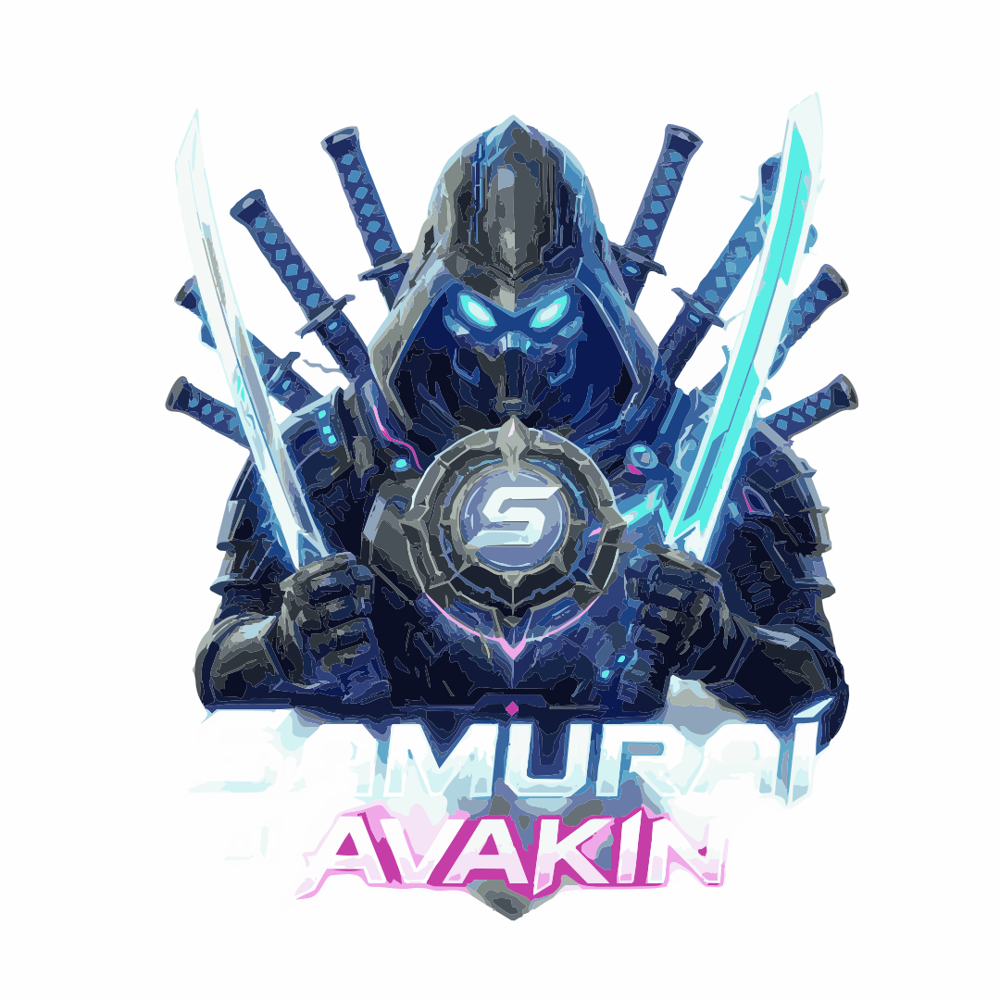

# Popup di avvio del sito (welcome modal)

Documentazione della sezione “popup di avvio” mostrata all’ingresso nel sito Samurai di Avakin.

## Comportamento
- ID modal: `welcomeModal` (`index.html:839`).
- Mostrata da `UI.initWelcome()` in `assets/js/ui.js:426` dopo **1200 ms**, solo se `localStorage` key `samurai:welcomeDone` non è `true`.
- `#welcomeSilent` (“Non mostrare più”) imposta `welcomeDone=true` e `welcomeSilent=true`, chiude il modal e mostra un toast.
- Qualsiasi chiusura del modal welcome imposta `welcomeDone=true` in `closeModal()` (`assets/js/ui.js:104`), quindi il popup non riappare automaticamente nelle visite successive sullo stesso browser/profilo.
- Sistema modal condiviso: `.modal` + `.modal-backdrop[data-close]` + `.modal-x`/`[data-close]`; focus trap, `Esc` chiude il modal top, `body.is-locked` blocca lo scroll.
- Avvio applicazione: `UI.initWelcome()` chiamato in `assets/js/main.js:1155`.

## Markup HTML completo (`index.html:839-859`)
```html
<div class="modal violet" id="welcomeModal" role="dialog" aria-modal="true" aria-labelledby="welcomeTitle">
  <div class="modal-backdrop" data-close></div>
  <div class="modal-box glass violet welcome-box">
    
    <span class="eyebrow violet" style="justify-content:center">Benvenuto</span>
    <h2 class="welcome-title violet-text" id="welcomeTitle">Il cerchio ti stava aspettando</h2>
    <p class="welcome-lead">
      Sei arrivato alla Gate dei Samurai di Avakin. Prima di entrare, dimmi come
      vuoi che questa esperienza si comporta.
    </p>
    <div class="welcome-opts">
      <div class="welcome-opt violet"><b>① Scegli il tuo nome</b><small>Personalizza il profilo nel pannello Account.</small></div>
      <div class="welcome-opt violet"><b>② Collega Avakin</b><small>Registra ID, server e personaggio principale.</small></div>
      <div class="welcome-opt violet"><b>③ Goditi lo spettacolo</b><small>Motion graphic, vetro liquido e zero noia.</small></div>
    </div>
    <div class="row" style="justify-content:center;margin-top:6px">
      <button class="btn btn-violet btn-lg" data-close>Entra nella Gate</button>
      <button class="btn btn-ghost" id="welcomeSilent">Non mostrare più</button>
    </div>
  </div>
</div>
```

## JavaScript completo rilevante

### Inizializzazione (`assets/js/ui.js:426-435`)
```js
function initWelcome() {
  if (store.get("welcomeDone", false)) return;
  setTimeout(() => openModal("welcomeModal"), 1200);
  $("#welcomeSilent").addEventListener("click", () => {
    store.set("welcomeDone", true);
    store.set("welcomeSilent", true);
    closeModal("welcomeModal");
    toast("Ok, nessun benvenuto la prossima volta", "Il Gate resta comunque aperta.", "ok");
  });
}
```

### Avvio (`assets/js/main.js:1155`)
```js
UI.initWelcome();
```

### Sistema modal usato dal popup (`assets/js/ui.js`, estratti)
```js
const modalStack = [];

function openModal(id) {
  const m = typeof id === "string" ? document.getElementById(id) : id;
  if (!m || m.classList.contains("is-open")) return;
  m.classList.add("is-open");
  document.body.classList.add("is-locked");
  modalStack.push(m);
  audio.hit("tap");
  m.dataset.prevFocus = document.activeElement?.id || "";
  const f = m.querySelector("input:not([type=file]), textarea, button:not(.modal-x)");
  if (f && window.innerWidth > 900) setTimeout(() => f.focus({ preventScroll: true }), 320);
}

function closeModal(m) {
  let target = m || modalStack[modalStack.length - 1];
  if (!target) return;
  audio.hit("close");
  if (target.id === "welcomeModal") store.set("welcomeDone", true);
  target.classList.remove("is-open");
  target.setAttribute("aria-hidden", "true");
  const i = modalStack.indexOf(target);
  if (i > -1) modalStack.splice(i, 1);
  else while (modalStack.length) modalStack.pop();
  if (!modalStack.length) document.body.classList.remove("is-locked");
  if (target.dataset.prevFocus) {
    const prev = document.getElementById(target.dataset.prevFocus);
    if (prev) prev.focus({ preventScroll: true });
  }
}

document.addEventListener("click", (e) => {
  const c = e.target.closest("[data-close]");
  if (c) { closeModal(c.closest(".modal")); return; }
  if (e.target.classList.contains("modal")) { closeModal(e.target); return; }
});

document.addEventListener("keydown", (e) => {
  if (e.key === "Escape") {
    if ($("#paletteWrap").classList.contains("is-open")) return togglePalette(false);
    if (modalStack.length) { closeModal(); return; }
  }
});
```

## CSS completo rilevante

### Base modal (`assets/css/components.css:1031-1064`)
```css
.modal {
  position: fixed;
  inset: 0;
  z-index: 120;
  display: grid;
  place-items: center;
  padding: 20px;
  opacity: 0;
  visibility: hidden;
  transition: opacity 0.4s var(--ease), visibility 0.4s;
}
.modal.is-open { opacity: 1; visibility: visible; }
.modal-backdrop { position: absolute; inset: 0; background: rgba(23, 37, 84, 0.72); backdrop-filter: blur(14px) saturate(120%); -webkit-backdrop-filter: blur(14px) saturate(120%); }
.modal.violet .modal-backdrop { background: rgba(35, 5, 61, 0.78); }

.modal-box {
  position: relative;
  z-index: 1;
  width: min(100%, 620px);
  max-height: min(88vh, 900px);
  overflow-y: auto;
  padding: var(--sp-6);
  border-radius: var(--r-xl);
  transform: translateY(28px) scale(0.96);
  opacity: 0;
  transition: transform 0.55s var(--ease-out), opacity 0.45s var(--ease);
  scrollbar-width: thin;
}
.modal.is-open .modal-box { transform: none; opacity: 1; }
.modal-box.violet { border: 1px solid var(--glass-violet-brd); box-shadow: var(--violet-shadow-3), var(--violet-glow); }
```

### Stili specifici welcome (`assets/css/components.css:1072-1107`)
```css
.welcome-box { width: min(100%, 780px); text-align: center; padding: var(--sp-8) var(--sp-6) var(--sp-6); }
.welcome-mon {
  width: 96px; height: 96px;
  margin: 0 auto var(--sp-5);
  border-radius: 50%;
  display: grid; place-items: center;
  font-family: var(--ff-jp);
  font-size: 2.6rem;
  color: var(--shiro-kabe);
  background: radial-gradient(circle at 35% 30%, rgba(203, 228, 249, 0.4), rgba(23, 37, 84, 0.9) 65%);
  border: 1px solid var(--glass-brd-hi);
  box-shadow: var(--shadow-3), 0 0 60px -12px rgba(59, 130, 246, 0.9);
  animation: floatY 6s var(--ease-in-out) infinite;
}
.welcome-title { font-family: var(--ff-display); font-size: clamp(1.8rem, 4.6vw, 3rem); line-height: 1.04; color: var(--shiro-kabe); }
.welcome-lead { color: var(--suna); max-width: 50ch; margin: var(--sp-4) auto 0; }
.welcome-opts { display: grid; grid-template-columns: repeat(3, 1fr); gap: var(--sp-3); margin: var(--sp-6) 0; text-align: left; }
.welcome-opt { padding: var(--sp-4); border-radius: var(--r-md); border: 1px solid rgba(203, 228, 249, 0.16); background: rgba(23, 37, 84, 0.3); transition: all 0.4s var(--ease-out); }
.welcome-opt:hover { transform: translateY(-4px); border-color: rgba(203, 228, 249, 0.42); box-shadow: var(--glow-soft); }
.welcome-opt.violet { border-color: rgba(233, 213, 255, 0.18); }
.welcome-opt.violet:hover { border-color: rgba(233, 213, 255, 0.45); box-shadow: var(--violet-glow-soft); }
.welcome-opt b { display: block; color: var(--shiro-kabe); font-size: 0.9rem; margin-bottom: 4px; }
.welcome-opt small { color: var(--suna); font-size: 0.78rem; line-height: 1.45; display: block; }
.welcome-box.violet .welcome-mon {
  background: radial-gradient(circle at 35% 30%, rgba(233, 213, 255, 0.45), rgba(35, 5, 61, 0.9) 65%);
  border-color: var(--glass-violet-brd-hi);
  box-shadow: var(--violet-shadow-3), 0 0 60px -12px rgba(168, 85, 247, 0.9);
}
```

### Logo inline/critico (`assets/css/core.css:69` area + `index.html` inline style)
```css
.welcome-logo { filter: drop-shadow(0 4px 16px rgba(0,0,0,.55)); border-radius: 14px; background: transparent; }
```

### Responsive
```css
@media (max-width: 1080px) { .welcome-opts { grid-template-columns: 1fr; } }
@media (max-width: 620px)  { .welcome-box { padding: var(--sp-6) var(--sp-4); } }
@media (max-height: 780px) {
  .welcome-box { padding: 34px 26px 24px; }
  .welcome-mon { width: 68px; height: 68px; font-size: 1.9rem; margin-bottom: 14px; }
  .welcome-title { font-size: clamp(1.5rem, 3.4vw, 2.1rem); }
  .welcome-lead { font-size: 0.92rem; }
  .welcome-opts { margin: 20px 0; }
  .welcome-opt { padding: 12px 14px; }
  .welcome-opt small { font-size: 0.74rem; }
}
```

## Storage / stato
- `samurai:welcomeDone` — `true` dopo chiusura o “Non mostrare più”.
- `samurai:welcomeSilent` — `true` se l’utente sceglie “Non mostrare più”.

## Dipendenze UI
- `UI.store.get/set`, `UI.toast`, `UI.openModal/closeModal`, `$` helper.
- Classi/variabili tema: `glass`, `violet`, `btn`, `eyebrow`, variabili `--ease`, `--ease-out`, `--glass-violet-*`, ecc.
